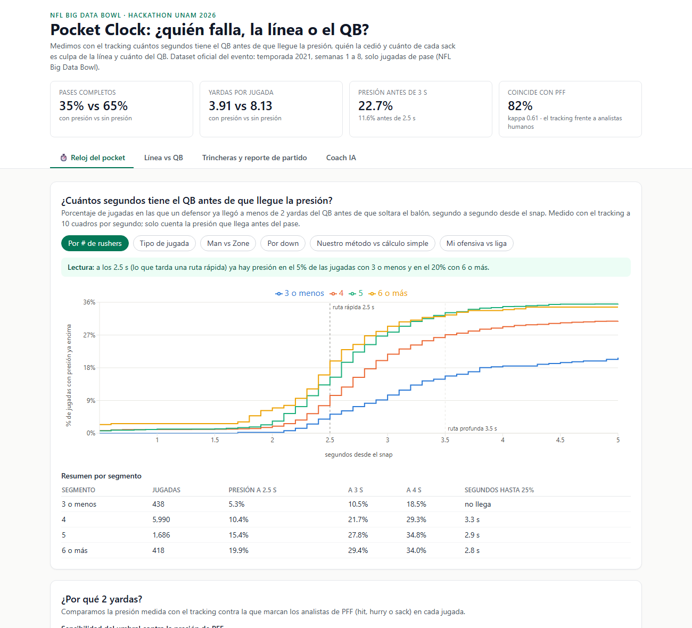
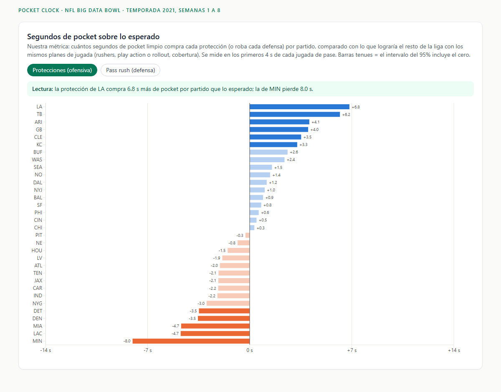
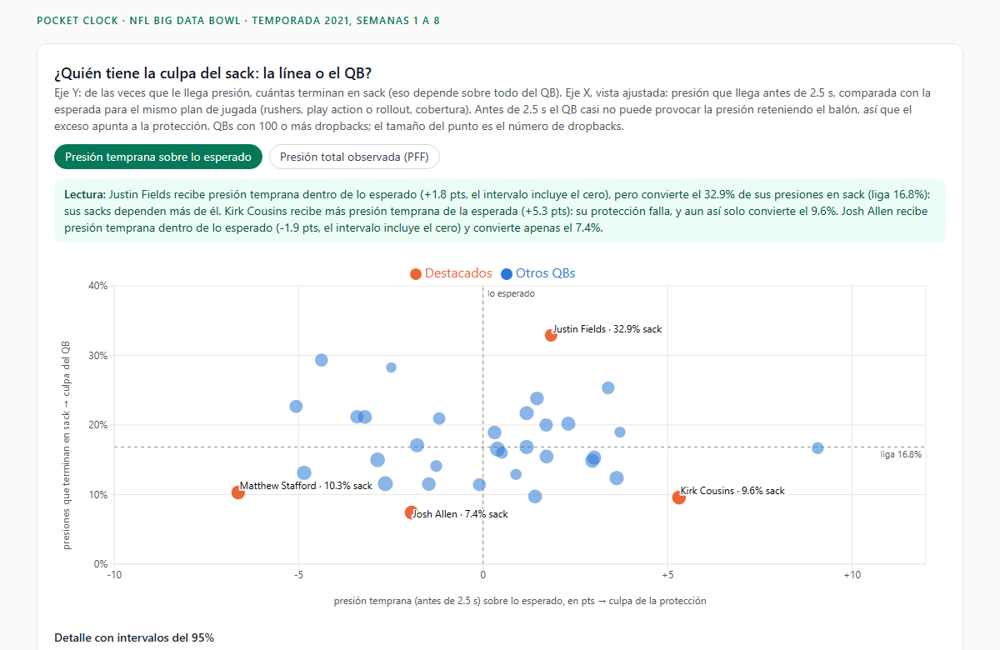

# Pocket Clock: ¿quién falla, la línea o el QB?

**Pocket Clock** es un tablero interactivo que mide, con el tracking cuadro por cuadro, cuántos segundos tiene el quarterback antes de que un defensor llegue a menos de 2 yardas de él y quién dejó pasar a ese defensor. Revela que la presión llega pronto (en el 23% de las jugadas antes de 3 s) y cuesta mucho: los pases completos bajan de 65% a 35% con presión. Nuestra métrica, **segundos de pocket sobre lo esperado**, muestra que la línea de los Rams compra 6.8 s de pocket por partido y la de los Vikings pierde 8.0 s, comparadas con el resto de la liga en los mismos planes de jugada. También separa la culpa de un sack: la protección de Justin Fields está dentro de lo esperado, pero el 32.9% de sus presiones terminan en sack, contra 7.4% de Josh Allen (liga 16.8%). Lo usarían un coordinador ofensivo para decidir a qué liniero ayudar y qué rutas caben antes de la presión, un GM para saber si arregla la línea o al QB y un comentarista para explicar un sack con datos.

Datos: dataset oficial del evento (NFL Big Data Bowl, temporada 2021, semanas 1 a 8, solo jugadas de pase).



## El hallazgo

1. **El reloj del pocket.** Cada rusher extra adelanta la presión: con 4 rushers el 25% de las jugadas ya tiene presión a los 3.3 s; con 6 o más, a los 2.8 s. El play action compra tiempo (17.9% de presión a los 3 s contra 25.0% en un dropback normal). Medirlo bien importa: si se ignora que el QB suelta el balón *porque* llega la presión, a los 4 s parecería que hay presión en el 57% de las jugadas, casi el doble del 30% real.
2. **Segundos de pocket sobre lo esperado.** Para cada jugada medimos cuánto antes del segundo 4 llegó la presión y lo comparamos con lo que pasa en el resto de la liga con el mismo plan (número de rushers, play action o rollout, cobertura). 11 de 32 protecciones se distinguen de lo esperado. Las mejores son los Rams (+6.8 s por partido) y Tampa Bay (+6.2 s), y la peor es Minnesota (−8.0 s). Entre las defensas, Cleveland (+7.0 s) y Filadelfia (+6.9 s) son las que más tiempo le roban al QB.
3. **¿Culpa de la línea o del QB?** La presión que llega antes de 2.5 s casi no depende de que el QB retenga el balón, así que la comparamos con la esperada para el mismo plan de jugada:
   - **Kirk Cousins** recibe +5.3 pts de presión temprana sobre lo esperado (IC95 +1.6 a +10.1) y solo el 9.6% de sus presiones termina en sack. El problema es su protección, como confirma el −8.0 s de Minnesota.
   - **Matthew Stafford** recibe −6.6 pts (IC95 −8.0 a −3.9): la protección de los Rams lo cuida.
   - **Justin Fields** recibe presión temprana dentro de lo esperado (+1.8 pts, el intervalo incluye el cero), pero convierte en sack el **32.9%** de sus presiones (IC95 23–44%). Sus sacks dependen más de él.
   - **Josh Allen** también está dentro de lo esperado (−1.9 pts) y convierte apenas el **7.4%** (IC95 4–14%).
4. **Quién cedió la presión.** En el primer cuadro en que un rusher llega a 2 yardas, identificamos al bloqueador que tenía asignado. En la liga, el 78% de esas presiones las cede la línea ofensiva, el 9% un RB o TE y el 13% llega sin bloqueador asignado.
5. **Trincheras con ajuste por rival.** De 206 linieros (T, G y C), solo 6 ceden claramente más presión de la esperada según los rushers que enfrentaron, por ejemplo Alejandro Villanueva (BAL, +4.3 por 100 snaps, IC95 +1.0 a +7.6), y 10 claramente menos.





## Para quién es

- **Coordinador ofensivo:** el reporte de partido dice a qué liniero darle ayuda, qué rusher rival cuidar y contra qué puesto suele alinearse, qué familia de rutas (rápidas 2.5 s, intermedias 3 s, profundas 3.5 s) cabe antes de la presión y cuántos segundos de pocket compra su línea.
- **GM / staff de personal:** el cuadrante separa si el problema de sacks se arregla con línea o es del QB.
- **Comentarista o aficionado:** el Coach IA (Amazon Nova) responde en español con las mismas cifras; si cita un número que no está en los datos, se reemplaza por el resumen calculado.

## Cómo verlo

Desde la raíz del proyecto (Windows, PowerShell):

```
cd dashboard
..\.hackathon\.tools\node\npm.cmd run build     # o: npm run build, si npm está en tu PATH
cd ..
.venv\Scripts\uvicorn backend.main:app
```

Abre `http://localhost:8000`. Cada pestaña tiene enlace directo (`#reloj`, `#segundos`, `#qb`, `#trincheras`, `#coach`). El Coach IA usa Amazon Bedrock con las llaves temporales del workshop en `.env` (copia `.env.example`); **si Bedrock no está disponible, todo el dashboard sigue funcionando**.

El método completo, la validación contra PFF, las limitaciones, los endpoints y el stack están en [docs/METODO.md](docs/METODO.md).
